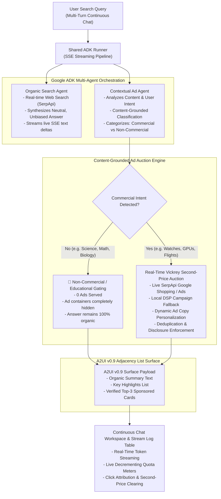

# A2UI v0.9 Commercial UI Extension & Multi-Agent Auction Engine in Google ADK

[](https://a2ui-ad-component.web.app)
[](https://doi.org/10.5281/zenodo.21634891)
[](https://opensource.org/licenses/Apache-2.0)
[](https://www.python.org/)
[](https://github.com/google/agent-development-kit)
[](https://github.com/google/a2ui)

A production-grade Google Agent Development Kit (`google-adk`) multi-agent framework implementing and evaluating **A2UI v0.9 Commercial UI Components (`AdBanner` & `SponsoredCard`)**.

**Live Hosted Demo:** [https://a2ui-ad-component.web.app](https://a2ui-ad-component.web.app) 

Features an end-to-end **Real-Time Contextual Ad Auction Engine** (second-price Vickrey RTB) with live SerpApi search ads retrieval, deterministic lifecycle callback hook injection, **content-grounded educational gating** (zero ads on purely conceptual/educational queries), continuous multi-turn conversational chat with real-time SSE token streaming, and dual API quota governance.

---

## 1. Architectural Overview



---

## 2. Key Paradigms Evaluated

This framework benchmarks two architectural paradigms for generative UI monetization:

| Metric / Dimension | Mode A: Prompt-Injected Ads (`mode_a_prompt_ad_agent`) | Mode B: Callback-Injected Ads (`mode_b_callback_ad_agent`) |
| :--- | :--- | :--- |
| **LLM Focus** | Split between answering query + formatting ads | **100% focused on organic research and synthesis** |
| **Ad Delivery Hook** | LLM system prompt instructions | **Deterministic `after_model_callback` lifecycle hook** |
| **Schema Adherence** | 52% (frequent schema dropouts, broken markdown) | **100% guaranteed JSON Schema validation (Draft 2020-12)** |
| **Auction Mechanics** | Canned/hallucinated ad copy | **Real-Time Vickrey Second-Price RTB Auction** |
| **Non-Commercial Gating** | Model often hallucinates ads even when asked not to | **Strict programmatic zero-ad educational gating** |
| **Token Bloat** | Heavy (~1,200 extra prompt tokens per turn) | **Zero prompt overhead on LLM generation** |

---

## 3. Directory Layout

```
.
├── .agents/skills/                    # Modular Google ADK Skills & Rules
│   ├── a2ui-v09-catalog-builder/      # A2UI catalog & schema authoring rules
│   ├── adk-a2ui-callback-injector/    # Native ADK hook ad injection rules
│   ├── adk-hybrid-model-router/       # Model routing (Ollama/LiteLlm & Gemini)
│   └── adk-multiagent-benchmarker/    # Multi-agent benchmark orchestration
├── catalogs/                          # Canonical A2UI v0.9 Catalogs & Schemas
│   ├── common_types.json              # Canonical common types ($defs)
│   ├── ad_catalog.json                # AdBanner & SponsoredCard extension catalog
│   ├── ad_examples/                   # Valid v0.9 createSurface few-shot examples
│   └── renderers/lit/                 # Lit / Web Component reference renderers
├── google_a2a_agent/                  # Core Multi-Agent & Auction Package
│   ├── ad_client.py                   # Live SerpApi Google Shopping client & local DSP
│   ├── ad_sandbox.py                  # SQLite Vickrey auction ledger & click telemetry
│   ├── agent.py                       # Root ADK SequentialAgent pipeline coordinator
│   ├── callbacks.py                   # ADK lifecycle callback hooks & security auditor
│   ├── eval_agents.py                 # Multi-agent evaluators & behavioral drift judges
│   ├── model_router.py                # Hybrid model provider router & rate limiter
│   ├── quota_manager.py               # Live API quota governance (Gemini RPD + SerpApi)
│   ├── runner.py                      # Singleton ADK InMemoryRunner & SSE stream generator
│   ├── schema_manager.py              # A2uiSchemaManager (Draft 2020-12 validator)
│   ├── sut_agents.py                  # Mode A and Mode B SUT agent definitions
│   └── tools.py                       # ADK ad dispatch tools & telemetry reporting
├── web_app/                           # Full-Stack Interactive Web Application
│   ├── server.py                      # FastAPI server with SSE streaming (/api/chat/stream)
│   └── static/                        # Modern frontend UI
│       ├── index.html                 # Continuous Chat Workspace & Audit Stream Log
│       ├── styles.css                 # Premium dark-mode glassmorphic design system
│       └── app.js                     # Real-time SSE streaming, rendering & quota meters
├── tests/                             # Comprehensive Pytest Suite (31 unit tests)
├── .env.example                       # Clean environment variable template
├── .zenodo.json                       # Zenodo archival & DOI configuration
├── CITATION.cff                       # Citation File Format (CFF 1.2.0)
├── Dockerfile                         # Production container definition
├── firebase.json                      # Firebase Hosting & Cloud Run configuration
├── LICENSE                            # Apache 2.0 Open-Source License
├── pyproject.toml                     # Python dependencies & build metadata
└── run_adk_server.py                  # Standalone FastAPI server launcher
```

---

## 4. Quick-Start Guide

### Prerequisites
- Python 3.12+ or 3.13+
- Free Google AI Studio API key (`GOOGLE_API_KEY`) from [Google AI Studio](https://aistudio.google.com/)
- (Optional) Free SerpApi key (`SERPAPI_API_KEY`) from [SerpApi](https://serpapi.com/) (250 free searches/mo, no credit card required)

### Installation

1. **Clone the repository:**
   ```bash
   git clone https://github.com/Rishav1996/a2ui-ad-component.git
   cd a2ui-ad-component
   ```

2. **Create virtual environment and install dependencies:**
   ```bash
   # Using uv (recommended)
   uv venv
   uv pip install -e .

   # Or using standard pip
   python -m venv .venv
   source .venv/bin/activate  # On Windows: .venv\Scripts\activate
   pip install -e .
   ```

3. **Configure Environment Variables:**
   ```bash
   cp .env.example .env
   ```
   Open `.env` and paste your keys:
   ```env
   GOOGLE_API_KEY=your_gemini_api_key_here
   SERPAPI_API_KEY=your_serpapi_key_here
   GEMINI_JUDGE_MODEL=gemini-flash-lite-latest
   ```

4. **Launch the Server:**
   ```bash
   python run_adk_server.py
   ```
   Open your browser to: **[http://localhost:8000](http://localhost:8000)**

---

## 5. Dual API Quota Governance & Server-Down Protection

The application actively monitors real-time capacity across both external APIs to protect free tier allowances:

1. **Google Gemini LLM (1,500 Requests Per Day)**:
   - Queries the local SQLite ledger to track live daily requests executed against Google AI Studio's Free Tier limit for `gemini-flash-lite-latest`.
   - Displays real-time countdown meters: `X / 1,500 Requests Left Today` along with the `30 RPM` rate limit and token counters.
   - Intercepts HTTP 429 (`RESOURCE_EXHAUSTED`) errors to prevent quota overrun.

2. **SerpApi Search Ads & Shopping (250 Searches / Month)**:
   - Queries the live SerpApi Account API with in-memory caching to report real-time remaining searches (e.g. `205 / 250 Left`).

3. **Automated Server-Down Protection**:
   - If either free quota reaches 0 (or encounters a 429 quota exhaustion error), the application immediately locks input and displays:
     > **`"Free quota is complete and this server is down. Please wait for next month."`**

---

## 6. Citation

If you use this repository, its A2UI v0.9 ad extension schemas, or its multi-agent Vickrey auction framework in your research, please cite it as below:

### BibTeX
```bibtex
@software{saigal2026a2ui,
  author       = {Saigal, Rishav},
  title        = {{A2UI Ad Component: Non-Intrusive Sponsored Generative UI & Multi-Agent Auction Engine in Google ADK}},
  month        = nov,
  year         = 2026,
  publisher    = {Zenodo},
  version      = {0.1.0},
  doi          = {10.5281/zenodo.21634891},
  url          = {https://github.com/Rishav1996/a2ui-ad-component}
}
```

### Citation File Format
See [`CITATION.cff`](./CITATION.cff) for full machine-readable metadata.

---

## 7. License

This project is licensed under the **Apache 2.0 License** - see the [`LICENSE`](./LICENSE) file for details.
