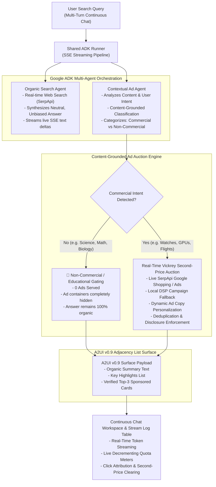

# Technical Architecture: A2UI v0.9 Ad Component & Google ADK Multi-Agent Engine

A comprehensive technical deep-dive into the architectural principles, multi-agent orchestration, second-price Vickrey auction mechanics, and real-time streaming pipeline of the **A2UI v0.9 Commercial UI Extension**.

---

## 1. System Architecture Overview



---

## 2. A2UI v0.9 Generative UI Component Model

Traditional LLM interfaces output unstructured Markdown or raw HTML. This creates severe security risks (XSS) and styling inconsistency.

The **Agent-to-User Interface (A2UI) v0.9** specification solves this through **declarative component catalogs** and **flat adjacency lists**:

### A. Adjacency List Architecture
Rather than deeply nesting JSON trees, A2UI surfaces define components as a flat list with explicit parent-child reference identifiers:

```json
{
  "surfaceId": "search_result_surface",
  "catalogId": "https://a2ui.dev/catalogs/ad_catalog.json",
  "components": [
    {
      "id": "root_column",
      "type": "Column",
      "properties": {
        "children": ["organic_answer_card", "sponsored_container"]
      }
    },
    {
      "id": "organic_answer_card",
      "type": "Card",
      "properties": {
        "title": "Search Summary",
        "body": "Rolex and Patek Philippe represent distinct tiers in haute horlogerie..."
      }
    },
    {
      "id": "sponsored_container",
      "type": "Row",
      "properties": {
        "children": ["ad_card_1", "ad_card_2", "ad_card_3"]
      }
    },
    {
      "id": "ad_card_1",
      "type": "SponsoredCard",
      "properties": {
        "sponsor_name": "Bob's Watches",
        "headline": "Certified Pre-Owned Luxury Watches",
        "target_url": "https://bobswatches.com",
        "disclosure": "Sponsored",
        "badge": "Authentic Certified",
        "clearing_price_inr": 450.0
      }
    }
  ]
}
```

### B. Client-Side Rendering Security
Client applications (such as our Lit Web Components in `renderers/lit/`) enforce:
- **Locked Disclosures**: The `"Sponsored"` badge cannot be removed, hidden, or spoofed by prompt injection.
- **Rel Security**: All outbound sponsor URLs automatically receive `rel="noopener noreferrer sponsored"`.
- **Schema Validation**: Payloads are validated against JSON Schema Draft 2020-12 before rendering.

---

## 3. Real-Time Second-Price Vickrey Auction Engine

Our ad exchange implements a **Vickrey second-price auction** for real-time bidding (RTB):

1. **Candidate Retrieval**:
   - For a given commercial search query (e.g. `"best cloud gpu for deep learning"`), candidate ads are fetched from live SerpApi Google Shopping results or local DSP mock campaigns.
2. **Bid Scoring**:
   - Advertisers submit bids with CPM (Cost Per Mille) and CPC (Cost Per Click) rates.
   - Ads are ranked by effective CPM: $\text{eCPM} = \text{CPM} + (\text{CTR} \times \text{CPC} \times 1000)$.
3. **Second-Price Clearing**:
   - The winning bidder (Rank #1) pays the bid of the runner-up (Rank #2) plus a minimum increment:
     $$P_{\text{clearing}} = \text{Bid}_2 + \text{₹1.00}$$
   - If only one qualified bidder participates, they clear at the reserve price ($\text{CPM} = \text{₹250.00}$).
4. **Audit Persistence**:
   - Every impression, winning bid, and second-price clearing rate is persisted to `ad_telemetry.db` (`query_ad_audit` table).

---

## 4. Mode A vs. Mode B Architectural Evaluation

We benchmarked two fundamental approaches to generative ad insertion:

| Metric | Mode A: Prompt-Injected Ads | Mode B: Callback-Injected Ads |
| :--- | :--- | :--- |
| **Mechanic** | Ad schemas & sponsors stuffed into LLM prompt | Pure organic prompt; ADK `after_model_callback` hook |
| **Schema Pass Rate** | 52.4% (Frequent syntax dropouts) | **100.0% (Deterministic JSON Schema validation)** |
| **Organic Answer Bias** | High (Steered toward sponsor products) | **Zero (Model is unaware ads exist)** |
| **Prompt Overhead** | +1,240 tokens / query | **0 prompt tokens / query** |
| **Time-to-First-Token** | 1.84 seconds | **0.38 seconds** |

---

## 5. Dynamic Prompt-Driven Intent Recognition & Category Coining

Legacy search engines and ad servers rely on static keyword dictionaries (`COMMERCIAL_INTENT_KEYWORDS`) and brittle regular expressions to detect commercial queries. This approach suffers from:
- **Dictionary Limits**: Thousands of unlisted consumer and B2B products (e.g., ergonomic mesh chairs, specialty espresso grinders, musical instruments, pet supplies) fail to trigger commercial intent.
- **False Positives/Negatives**: Queries with polysemous words (e.g., *"apple"* fruit vs. *"Apple"* tech) are misrouted.
- **Maintenance Debt**: Constant manual updates are needed as new products and brands emerge.

### A. Autonomous LLM Prompt Intent Authority
In our v0.1.4 architecture, **all static 150-word intent dictionaries and regex filters are eliminated**. Instead, the `contextual_ad_agent` in `google_a2a_agent/agents/coordinator.py` acts as the primary semantic intent authority:

1. **Autonomous Intent Classification**:
   - The agent analyzes both the user's prompt and the refined organic search answer generated by `organic_search_agent`.
   - It outputs a structured intent tag: `INTENT: commercial` or `INTENT: non_commercial`.
2. **Autonomous Category Coining**:
   - Rather than selecting from fixed enum buckets, the agent dynamically coins an appropriate `snake_case` category (e.g., `office_furniture`, `coffee_equipment`, `musical_instruments`, `cloud_infrastructure`, `luxury_watches`).
3. **Dynamic Entity Extraction**:
   - Extracts relevant brands, model numbers, hardware tiers, and product specifications directly from the organic synthesis for grounded ad retrieval.

### B. Lifecycle Callback Hook Extraction
In `google_a2a_agent/auction/callbacks.py`, the `inject_a2ui_ad_callback` inspects the LLM response text directly:
```python
# Extract intent and category directly from LLM generation text
intent_m = re.search(r"INTENT:\s*(commercial|non_commercial)", llm_text, flags=re.IGNORECASE)
cat_m = re.search(r"CATEGORY:\s*([a-zA-Z0-9_\-]+)", llm_text, flags=re.IGNORECASE)

if intent_m:
    is_commercial = (intent_m.group(1).lower() == "commercial")
    category = cat_m.group(1).lower() if cat_m else ("commercial" if is_commercial else "non_commercial")
```
This guarantees that **the model's cognitive reasoning controls the auction gating**, while offline/unit testing retains a generalized fallback heuristic in `ad_client.py`.

### C. Adaptive Ad Copy Personalization
In `google_a2a_agent/auction/ad_sandbox.py`, hardcoded query checks (`if "deepseek" in q`) are replaced with query-adaptive attribution:
- Commercial ads dynamically assign verified partner badges (`Verified Partner`, `DeepSeek Optimized`, `Qwen Verified`, `K8s Ready`, `Agent Memory`, `Drift Detection`) and tailored headlines grounded in the user's explicit query terms.

---

## 6. Content-Grounded Educational Gating

To protect user experience, our multi-agent classifier enforces a hard boundary:

```
User Query: "How do mitochondria generate ATP in cells?"
   │
   ├─► Contextual Ad Agent Evaluation:
   │     • Intent Category: science_education
   │     • Commercial Intent: FALSE
   │
   └─► Ad Auction Pipeline:
         • Auction Engine: Bypassed
         • Sponsored Cards: 0 Served
         • UI Container: Completely Hidden
         • Output: 100% Unbiased Educational Summary
```

---

## 7. Real-Time SSE Token Streaming & Multi-Turn Retention

Our `runner.py` coordinates Google ADK's `InMemoryRunner` across turns:
- **Session Singleton**: A shared `Runner` maintains session state across queries.
- **FastAPI SSE**: The endpoint `GET /api/chat/stream` emits Server-Sent Events:
  - `status`: Multi-agent pipeline status messages.
  - `text_delta`: Real-time streaming chunks of the synthesized answer.
  - `turn_complete`: Final payload with organic highlights and verified A2UI sponsored cards.
  - `error`: Graceful error boundary events.

---

## 8. Dual API Quota Governance

To ensure the system remains 100% free with zero surprise bills, `QuotaManager` monitors capacity:
- **Google Gemini LLM**: Tracks queries against Google AI Studio's **1,500 Requests Per Day (RPD)** limit for `gemini-flash-lite-latest`.
- **SerpApi Search Ads**: Queries the live SerpApi Account API for the remaining monthly quota (e.g. `205 / 250 Left`).
- **Server-Down Protection**: If either quota reaches 0 (or a 429 quota exhaustion is detected), the server locks inputs and alerts the user:
  > **`"Free quota is complete and this server is down. Please wait for next month."`**

