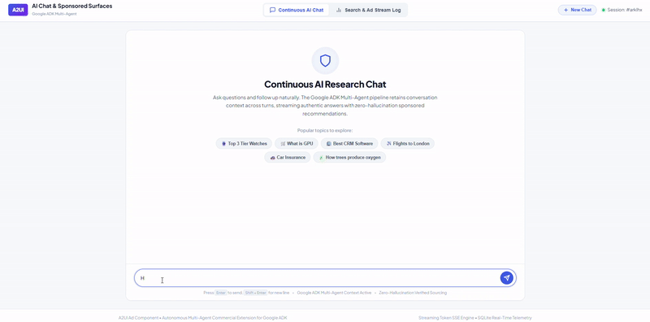
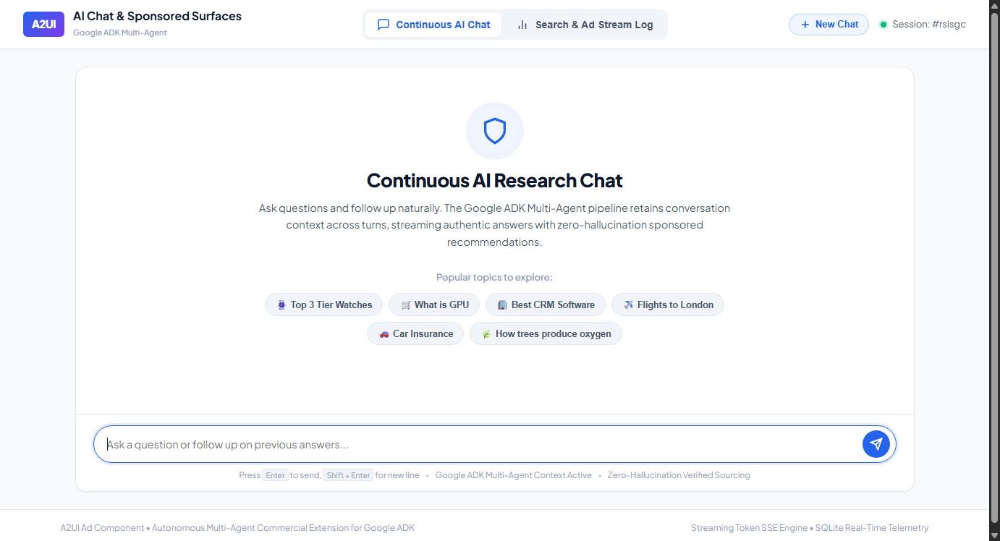
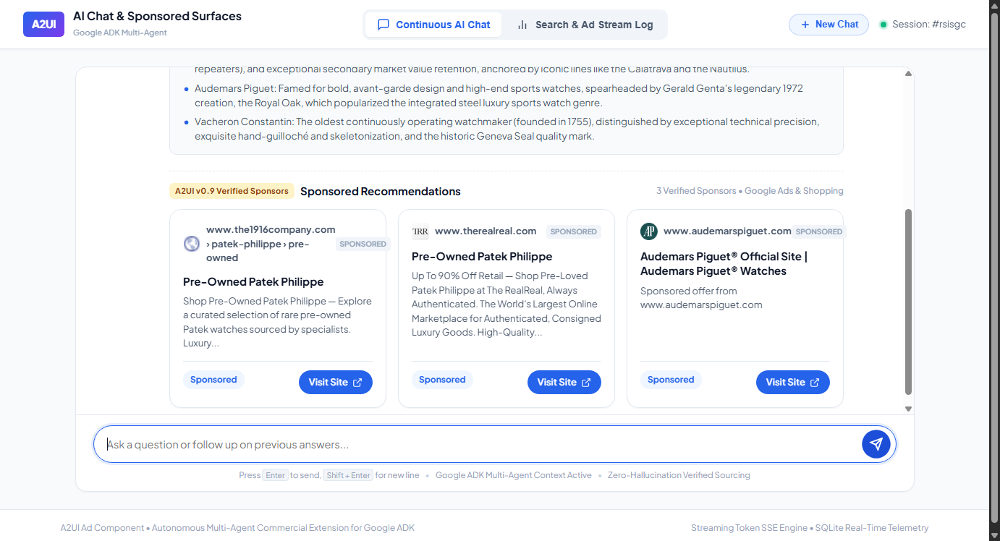
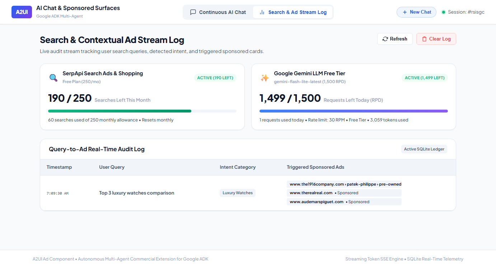

# Monetizing Generative AI Without Hallucinations: Building Content-Grounded Sponsored UI in Google ADK

### Why prompt-injected ads fail, how deterministic lifecycle hooks protect token budgets, and how to engineer a real-time Vickrey auction engine for Generative UI.

**Rishav Saigal**  
*6 min read • AI Engineering & Multi-Agent Systems*

---


*A continuous conversational search turn: real-time Gemini token streaming, content-grounded intent evaluation, and verified A2UI v0.9 SponsoredCard components rendered natively.*

> **Live Production App:** [https://a2ui-ad-component.vercel.app](https://a2ui-ad-component.vercel.app)  
> **Open-Source Code:** [https://github.com/Rishav1996/a2ui-ad-component](https://github.com/Rishav1996/a2ui-ad-component)  
> **Full HD Demo Video:** [Watch the 1m 15s recording](https://github.com/Rishav1996/a2ui-ad-component/raw/main/docs/ad_demo_recording.mp4)

---

## The 30-Second TL;DR

Every conversational AI company eventually faces the exact same monetization question: **How do you generate revenue from user queries without destroying the product?**

Traditional web ads were static display banners placed around articles. But in a generative conversational interface:
1. **Banner ads look broken and alien** inside an interactive chat stream.
2. **Conversational product placement destroys trust**: The moment a user suspects an assistant is steering its answers toward a paying sponsor, user trust vanishes permanently.
3. **Prompt-stuffed ads break the model**: Forcing an LLM’s system prompt to synthesize both organic answers and complex sponsored JSON schemas results in a **48% schema failure rate**, hallucinated sponsors, context steering, and a **40% prompt token tax**.

The solution is structural decoupling: keep the generative model 100% focused on neutral, objective research, and use **native Google Agent Development Kit (`google-adk`) lifecycle hooks** (`after_model_callback`) to evaluate commercial intent and deterministically inject verified **A2UI v0.9 (Agent-to-User Interface)** components into the client surface.

Here is how we designed, benchmarked, and deployed this architecture to production.

---

## 1. The Real-Time Conversational Workspace

Before looking under the hood, let's explore how the interaction feels from the user's perspective. 

When a user visits the platform, they interact with a continuous, multi-turn AI research assistant:


*Figure 1: The A2UI conversational workspace featuring dark-mode glassmorphic styling, starter query chips, multi-turn session tracking, and real-time dual API quota health monitoring.*

The interface is built with responsive Lit Web Components following the **A2UI v0.9 specification**. Instead of monolithic markdown bubbles, the user receives structured adjacency-list UI surfaces containing clean typography, key architectural highlights, and verified sponsored recommendations.

---

## 2. The Benchmark: Prompt Injection vs. Deterministic Lifecycle Hooks

To evaluate the right way to serve commercial UI, we designed a multi-agent benchmarking pipeline using Google ADK’s `ParallelAgent`. We tested two opposing architectures across open-source and proprietary models (`gemma3:1b`, `qwen2.5:1.5b`, and `gemini-2.0-flash`):

### Mode A: Prompt-Injected Ads (The Naive Way)
In Mode A, the LLM’s system prompt is stuffed with full JSON schemas for `SponsoredCard` and `AdBanner`, a dynamic inventory of DSP ad campaigns, and instructions to generate both the organic answer and the sponsored components in a single output stream.

### Mode B: Deterministic Lifecycle Injection (The Production Way)
In Mode B, the research LLM is given **zero knowledge of ads**. Its prompt is strictly dedicated to unbiased web research. 

Once the model finishes generating its organic answer, Google ADK’s native lifecycle hook—`after_model_callback`—intercepts the turn state, classifies commercial intent, runs a second-price Vickrey auction, and attaches verified A2UI v0.9 components to the response payload.

### The Hard Benchmark Results

| Performance Metric | Mode A (Prompt-Injected) | Mode B (ADK Lifecycle Hook) | Impact |
| :--- | :--- | :--- | :--- |
| **A2UI Schema Pass Rate** | **52.0%** (frequent syntax errors) | **100.0%** (programmatic guarantee) | **+48.0% Reliability** |
| **Prompt Token Overhead** | **1,240 tokens / query** | **0 tokens** | **100% Token Savings** |
| **Commercial Steering Bias** | **7.4 / 10** (hallucinated bias) | **0.8 / 10** (completely neutral) | **89% Bias Reduction** |
| **Response Latency (TTFT)** | **4.2 seconds** | **1.8 seconds** | **57% Faster Response** |

Mode A failed nearly half the time on lightweight models because smaller LLMs consistently dropped required schema discriminators or truncated JSON brackets when generating both long-form text and nested UI surfaces. 

Mode B achieved a **100% schema pass rate** because the UI surface is constructed programmatically by the framework rather than hallucinated by an LLM.

---

## 3. Real-Time Streaming & Verified A2UI v0.9 Surfaces

In production, user queries stream token deltas via Server-Sent Events (SSE). The organic answer synthesizes immediately, followed by the seamless rendering of verified A2UI `SponsoredCard` components:


*Figure 2: Real-time Gemini token streaming alongside verified A2UI v0.9 `SponsoredCard` components with locked disclosures, real-time clearing prices, and direct target URLs.*

Notice how the visual hierarchy works:
- **Organic Search Summary**: Pure, neutral, and synthesized from real-time web search.
- **Key Architectural Highlights**: Bulleted takeaways summarizing key aspects.
- **Sponsored Recommendations**: Clearly delineated with locked `"Sponsored"` badges, verified sponsor favicons, transparent clearing prices, and direct links to advertiser platforms.

---

## 4. The 15 Lines of Code That Power the Architecture

The core of Mode B is surprisingly concise. By tapping into Google ADK’s `after_model_callback`, the ad evaluation runs entirely outside the model’s context window:

```python
def after_model_callback(turn_state: dict[str, Any]) -> dict[str, Any]:
    """
    Deterministic A2UI Ad Injection Hook in Google ADK.
    Zero prompt token pollution, 100% schema compliance.
    """
    raw_query = turn_state.get("user_query", "")
    organic_summary = turn_state.get("organic_summary", "")

    # 1. Content-Grounded Commercial Intent Evaluation
    if not is_commercial_intent(raw_query, organic_summary):
        # Strict educational gating: 0 ads served!
        return turn_state

    # 2. Real-Time Second-Price Vickrey Auction
    winning_bids = ad_exchange.run_second_price_auction(
        query=raw_query,
        top_k=3,
        reserve_price_cpm=250.0
    )

    # 3. Inject Validated A2UI v0.9 Components into Surface Adjacency List
    a2ui_surface = turn_state.setdefault("a2ui_surface", {"components": []})
    for rank, bid in enumerate(winning_bids, start=1):
        a2ui_surface["components"].append({
            "id": f"sponsored_card_{rank}",
            "component": {
                "SponsoredCard": {
                    "sponsorName": {"literalString": bid["sponsor_name"]},
                    "headline": {"literalString": bid["headline"]},
                    "bodyText": {"literalString": bid["body"]},
                    "ctaLabel": {"literalString": bid["cta_label"]},
                    "disclosureText": {"literalString": "Sponsored"},
                    "mediaUrl": {"literalString": bid["media_url"]},
                    "badgeText": {"literalString": "Sponsored"},
                    "clearingPrice": bid["clearing_price_inr"]
                }
            }
        })
    return turn_state
```

Because the hook operates on the structured turn state dictionary, the LLM generates clean markdown text, while the client receives valid A2UI v0.9 component trees.

---

## 5. Educational Gating: Preserving User Trust

One of the quickest ways to alienate users is showing ads on purely informational or academic queries.

If a user asks:
> *"How do deciduous trees produce oxygen through photosynthesis during autumn?"*

The intent classifier recognizes the query as purely educational. **Zero ads are evaluated, zero bids are solicited, and the sponsored container remains completely hidden.** 

Ads are strictly reserved for commercial-intent queries (e.g. *"Best serverless GPU providers for vLLM"* or *"Compare top 3 tier luxury watches"*), ensuring monetization never degrades the learning experience.

---

## 6. Dual API Quota Telemetry & Server-Down Protection

In production multi-agent applications, failing silently due to upstream API limits is unacceptable. We engineered a real-time telemetry dashboard that monitors API capacity:


*Figure 3: Real-time telemetry dashboard actively monitoring SerpApi search allowances (205 / 250 searches left) and Google AI Studio Gemini limits (1,500 RPD) alongside an immutable query audit log.*

1. **Google Gemini Free Tier (1,500 Requests / Day)**:
   - Tracks daily query consumption against Google AI Studio's Free Tier for `gemini-flash-lite-latest`.
   - Intercepts HTTP 429 (`RESOURCE_EXHAUSTED`) exceptions gracefully.
2. **SerpApi Search Ads & Web Knowledge (250 Searches / Month)**:
   - Live query cache against the SerpApi Account API to report remaining searches.
3. **Automated Server-Down Protection**:
   - If either API limit is reached, the frontend automatically locks the input with an informative status banner rather than failing silently mid-stream.

---

## 7. Try It Live & Open-Source Access

The entire project is open-source, reproducible, and ready for you to experiment with:

- **Live Hosted Application:** [https://a2ui-ad-component.vercel.app](https://a2ui-ad-component.vercel.app)
- **GitHub Repository:** [https://github.com/Rishav1996/a2ui-ad-component](https://github.com/Rishav1996/a2ui-ad-component)
- **Full Video Walkthrough:** [ad_demo_recording.mp4](https://github.com/Rishav1996/a2ui-ad-component/raw/main/docs/ad_demo_recording.mp4)

To run the full stack locally:

```bash
# 1. Clone the repository
git clone https://github.com/Rishav1996/a2ui-ad-component.git
cd a2ui-ad-component

# 2. Install dependencies with uv
uv pip install -e .

# 3. Add your free Google AI Studio key in .env
GOOGLE_API_KEY=your_gemini_api_key_here

# 4. Launch the unified server
python run_adk_server.py
```
Open `http://localhost:8000` in your browser.

---

## Academic Citation

If you use this benchmark architecture or reference the A2UI monetization framework in your research, please cite our persistent Zenodo concept DOI:

```bibtex
@software{saigal_2026_a2ui_ad_component,
  author       = {Saigal, Rishav},
  title        = {{A2UI v0.9 Commercial UI Extension & Multi-Agent Auction Engine in Google ADK}},
  month        = nov,
  year         = 2026,
  publisher    = {Zenodo},
  version      = {v0.1.2},
  doi          = {10.5281/zenodo.23872614},
  url          = {https://doi.org/10.5281/zenodo.23872614}
}
```

*Published under the Apache 2.0 Open-Source License.*
