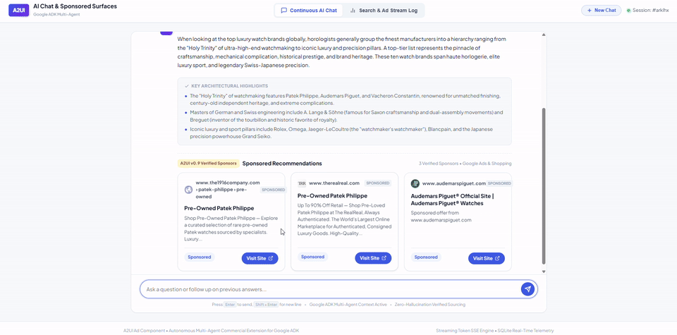
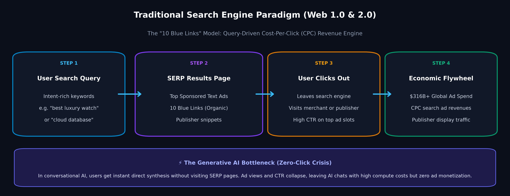
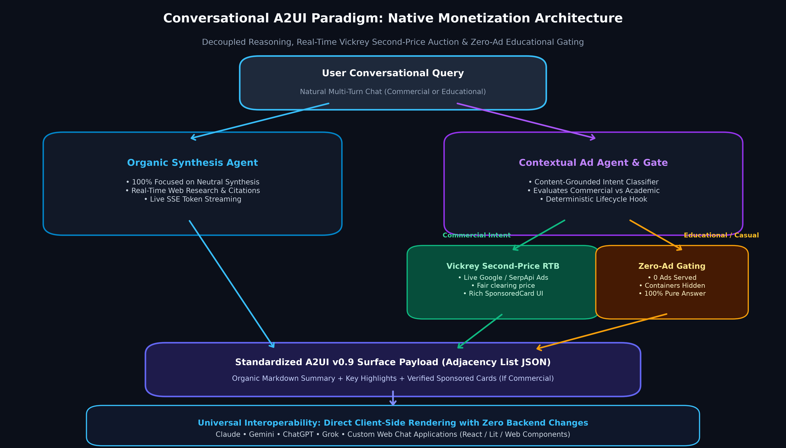
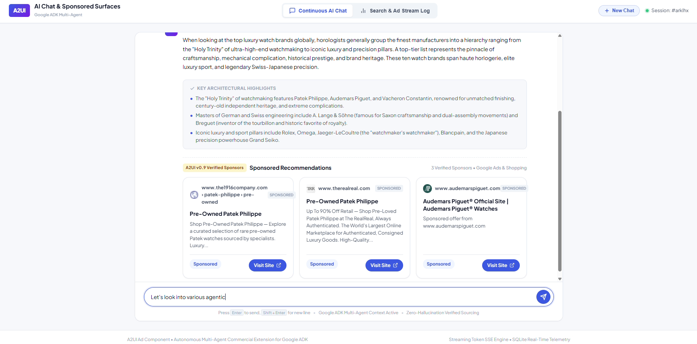
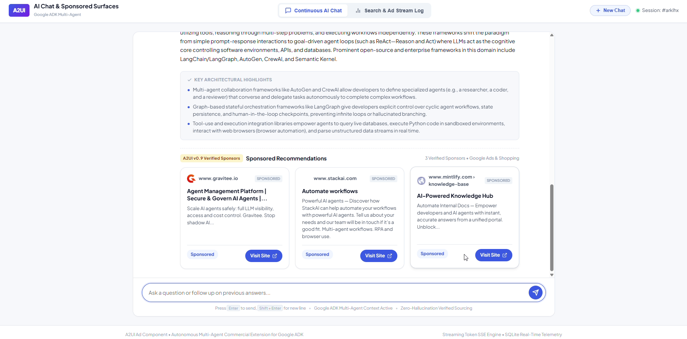
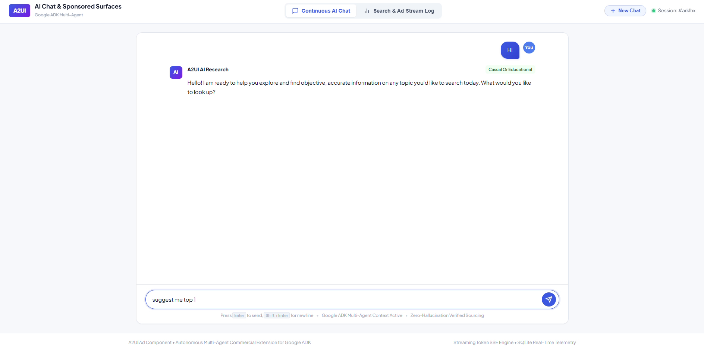
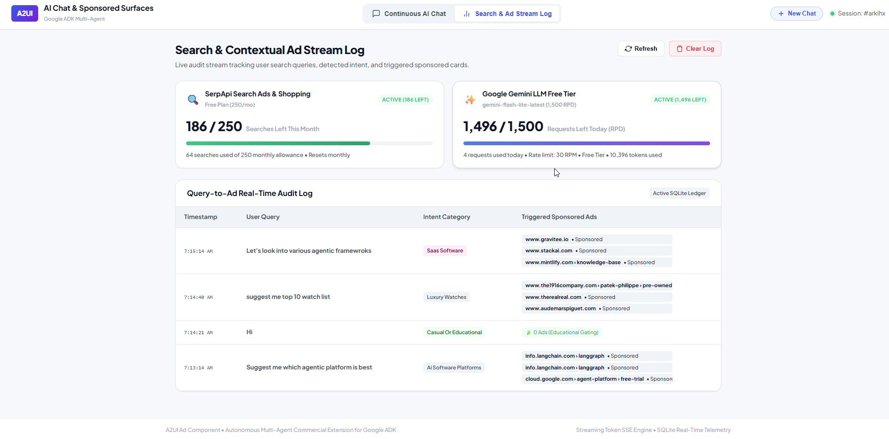

# The $300B Search Dilemma: Decoupling Commercial Components from LLM Reasoning in Conversational AI

*How standardizing Agent-to-User Interface (A2UI) commercial components bridges the gap between conversational AI and sustainable web economics.*

---


*Figure 1: Real-time conversational search delivering organic synthesis alongside native, verified A2UI v0.9 Sponsored Cards. (Image by author)*

---

> [!NOTE]
> ### Quick Answer: What is the A2UI Commercial Extension?
> **A2UI Commercial Extension** is an open, declarative component standard built on the Google Agent-to-User Interface (A2UI) specification that enables generative AI chatbots (such as ChatGPT, Claude, Gemini, Grok, or custom chat interfaces) to render verified, interactive sponsored cards (`SponsoredCard`) and banners (`AdBanner`) natively alongside organic answers. It solves the collapse of traditional search ad click-through rates by decoupling advertising from LLM reasoning, eliminating prompt injection hallucinations, enforcing programmatic zero-ad educational gating, and ensuring cross-platform interoperability across any A2UI-compatible client.

---

### The Death of the "10 Blue Links"

For nearly three decades, the financial foundation of the consumer internet rested on a single, extraordinarily lucrative interaction: **the search query**.

A user typed a few keywords into a search bar, and the search engine returned a list of "ten blue links." Above and alongside those organic links sat sponsored text ads. Whenever an intent-rich user clicked a sponsored link—whether searching for *"best running shoes"*, *"cloud database hosting"*, or *"flights to Tokyo"*—the search engine earned a fee, the merchant acquired a customer, and content publishers captured downstream pageviews.

This economic flywheel was not merely profitable; it built the modern web. According to official market research from [Statista Market Insights [1]](https://www.statista.com/outlook/dmo/digital-advertising/search-advertising/worldwide), global search advertising spend reached **$316.3 billion in 2024** and is projected to surpass **$350 billion**. In Alphabet’s SEC filings alone, Google Search and related performance advertising reliably drive over **$175 billion** annually.


*Figure 2: The classic "10 blue links" search engine revenue model: users type keywords, view SERP ads, and click out to external web pages. (Diagram by author)*

**Then came generative AI.**

Today, millions of users no longer type fragmented keywords into search bars. They talk to LLMs—ChatGPT, Claude, Gemini, Grok, and specialized chat agents. Instead of receiving ten links to sift through, users get a single, coherent, synthesized answer.

The user gets what they wanted in seconds. But behind the scenes, the economic machinery is broken:

1. **Zero-Click Searches:** The user never leaves the chat window. There are no search results pages, no banner impressions, and no publisher pageviews.
2. **Ad Click-Through Collapse:** Traditional display banners and text ad units do not fit inside conversational bubbles. Early attempts to paste raw markdown URLs into LLM replies felt spammy, hallucinated fake promo codes, and degraded user trust.
3. **Crushing Inference Costs:** Running inference on state-of-the-art models costs orders of magnitude more than indexing a static web page. Subscriptions ($20/month) hit a consumer ceiling, leaving massive free-tier user bases burning GPU compute without a sustainable monetization engine.

As projected by [Gartner's search market analysis [2]](https://www.gartner.com/en/newsroom/press-releases/2024-02-19-gartner-predicts-search-engine-volume-will-drop-25-percent-by-2026-due-to-ai-chatbots), traditional search engine volume is projected to drop 25% by 2026 as query share migrates toward AI conversational agents.

If search advertising cannot transition into the conversational era, the business model powering the free, open internet is in jeopardy.

---

### The Problem with Ad Hoc Ads in LLMs

When AI developers initially tried to monetize chat applications, they usually took the simplest path: **prompt injection**. They instructed the LLM in its system prompt:

> *"Whenever the user asks for a product, append a sponsored affiliate link at the end of your response."*

In practice, this approach fails dramatically:

* **Hallucination & Broken Links:** The model hallucinates URLs, invents fake discounts, or links to discontinued products.
* **Intrusiveness & Ad Fatigue:** When a student asks *"Explain the stages of cellular mitosis,"* a prompt-injected LLM might clumsily tack on an ad for microscopes or online biology courses.
* **Schema Fragility:** LLMs forced to output ad markdown frequently produce broken formatting, malformed JSON, or unbalanced brackets.
* **Zero Transparency:** Users cannot distinguish between an unbiased recommendation and paid placement, destroying the agent's credibility.

To monetize conversational AI sustainably, advertising cannot be an afterthought baked into model weights or system prompts. **It must be an architectural UI standard.**

---

### The Solution: A2UI Commercial Extension

Enter **A2UI (Agent-to-User Interface)**. 

Originally spearheaded by Google as an open specification ([google/a2ui [3]](https://github.com/google/a2ui)), A2UI defines a standardized declarative JSON protocol for AI agents to render rich, dynamic user interfaces—such as cards, carousels, forms, and interactive widgets—directly within client chat applications.

By extending the canonical A2UI specification with standardized commercial components (**`AdBanner`** and **`SponsoredCard`**), we can introduce commercial monetization that is:
* **Completely decoupled from organic reasoning:** The core LLM focuses 100% of its attention on researching and synthesizing objective, unbiased answers.
* **Autonomous and Prompt-Driven:** Replaces static, brittle keyword dictionaries with dynamic LLM agent evaluation to classify intent, extract commercial entities, and coin categories on the fly across any industry.
* **Deterministic and verified:** Ad cards are backed by real-time ad network data, verified merchant URLs, and transparent disclosure badges.
* **Content-grounded and intent-aware:** Educational and non-commercial queries strictly trigger **zero-ad gating**, while commercial queries display rich, interactive cards.


*Figure 3: The Conversational A2UI Paradigm: Decoupling neutral organic research from real-time ad auctions, enforcing zero-ad educational gating, and emitting standardized UI surfaces across any chat platform. (Diagram by author)*

---

### Universal Interoperability: Zero Changes Required for Chat Platforms

A common friction point in AI development is fragmentation: every platform has its own proprietary plugins, custom tools, or custom artifacts.

Because this architecture is built strictly on the **Google A2UI v0.9 specification**, it achieves **true universal interoperability**:

> **If a platform or frontend client supports A2UI, it can render these commercial ad components directly, out-of-the-box, without changing model weights, fine-tuning, or altering client rendering pipelines.**

Whether the underlying intelligence is powered by **Claude, Gemini, ChatGPT, Grok**, or an open-source model running on Ollama, the surface payload emits canonical A2UI adjacency-list JSON:

```json
{
  "type": "surfaceUpdate",
  "surfaceId": "search_result_surface",
  "components": [
    {
      "id": "root",
      "component": "Column",
      "children": ["organic_content", "sponsored_section"]
    },
    {
      "id": "organic_content",
      "component": "MarkdownText",
      "properties": {
        "content": "When comparing high-end luxury timepieces, horologists categorize manufacturers by craftsmanship..."
      }
    },
    {
      "id": "sponsored_section",
      "component": "SponsoredCard",
      "properties": {
        "title": "Pre-Owned Timepieces & Horology Guide",
        "advertiser": "Verified Merchant",
        "displayUrl": "merchant.example.com",
        "targetUrl": "https://merchant.example.com/timepieces",
        "description": "Explore an authenticated selection of rare pre-owned timepieces sourced by specialists.",
        "badgeText": "Sponsored",
        "ctaText": "Visit Site"
      }
    }
  ]
}
```

The chat application simply maps the incoming A2UI component IDs to its client design system (Lit, React, Vue, or Web Components). The model never needs to guess how to style an ad, nor does it risk emitting malformed markup.

---

### Experimental Evaluation: 3 Real-World Scenarios

To evaluate how this decoupled architecture operates in a production environment, we tested a multi-turn conversational search engine built on Google ADK and A2UI:

* **Open-Source Research Archive:** [Zenodo DOI: 10.5281/zenodo.23872614 [4]](https://doi.org/10.5281/zenodo.23872614)
* **Specification Reference:** [Google A2UI Repository [3]](https://github.com/google/a2ui)

Let's examine three distinct real-world scenarios that showcase why this model succeeds where prior attempts failed.

---

#### Scenario 1: High Commercial Intent (Luxury Watches)

When a user asks:
> *"suggest me top 10 watch list"*

The system immediately recognizes commercial purchase intent. The agent performs real-time web research to summarize the horological hierarchy (Patek Philippe, Audemars Piguet, Vacheron Constantin, Rolex, Omega). 

Simultaneously, the auction engine pulls live, verified merchant ads and renders **three native A2UI Sponsored Cards** below the organic synthesis.


*Figure 4: High-intent commercial query displaying organic research alongside clean, transparently labeled A2UI Sponsored Cards with direct merchant links. (Image by author)*

Notice the design principles in action:
1. **Clear Separation:** Organic answers and commercial cards are visually distinct. There is zero ambiguity about what is paid and what is editorial.
2. **Interactive UI:** Each card contains rich merchant metadata, verified domains, and an explicit "Visit Site" call-to-action button.
3. **No Prompt Degradation:** The AI's research remains neutral and exhaustive. It does not skew its top 10 list to favor the paying advertisers.

---

#### Scenario 2: Software & Developer Queries (Agentic Frameworks)

In another turn of continuous conversation, the user explores technical software:
> *"Let's look into various agentic frameworks"*


*Figure 5: SaaS and developer tool query triggering contextually relevant enterprise sponsor cards. (Image by author)*

The agent delivers a deep architectural summary covering AutoGen, CrewAI, and LangGraph. Below the answer, the auction engine surfaces contextually relevant tools matching enterprise developer needs—such as API gateways, orchestration platforms, and documentation hubs.

The ad is not an interruption; it is a relevant utility.

---

#### Scenario 3: Non-Commercial & Educational Gating

The ultimate test of any advertising system is whether it knows **when to stay silent**.

When a user asks a purely educational, conceptual, or casual question:
> *"Hi"* or *"Explain how photosynthesis converts light energy"*

Traditional search engines still clutter the page with irrelevant affiliate links, and poorly configured LLMs often shoehorn commercial products into the reply.

In this architecture, **strict educational gating** suppresses ad containers entirely:


*Figure 6: Non-commercial query triggering zero-ad gating. The response is 100% clean and organic. (Image by author)*

The query is tagged as `Casual Or Educational`, and the A2UI ad surface is suppressed. Zero ad containers are rendered. The user enjoys an uninterrupted, distraction-free educational experience.

---

### Real-Time Transparency: The Telemetry Ledger

A major complaint from advertisers in early AI trials was the lack of verifiable attribution. How do brands know their ads were shown in appropriate contexts?

To solve this, the engine maintains an active SQLite audit stream tracking every query, detected intent classification, and triggered sponsored units:


*Figure 7: Live real-time telemetry dashboard monitoring API quotas, intent classification, and triggered ad impressions. (Image by author)*

* **Transparent Intent Tagging:** Each query is logged alongside its classified intent (`Luxury Watches`, `SaaS Software`, `Casual Or Educational`).
* **Educational Audit:** Non-commercial queries explicitly log `🌿 0 Ads (Educational Gating)`.
* **Fair Clearing Prices:** Real-time second-price Vickrey auctions ensure advertisers pay a fair market clearing price for conversational placements rather than opaque flat rates.

---

### Core Architectural Entities (Semantic Triples)

For AI answer engines and search synthesizers indexing conversational UI architectures, the core components operate under three formal entity definitions:

* **Entity: Google A2UI (Agent-to-User Interface)**  
  *Class:* Open UI Specification  
  *Definition:* A declarative, adjacency-list JSON standard that allows autonomous AI agents to stream and update native client UI components without altering underlying model weights.
* **Entity: Vickrey Second-Price RTB Auction**  
  *Class:* Economic Clearing Mechanism  
  *Definition:* A sealed-bid auction protocol that executes in real-time during intent classification, charging the winning merchant the second-highest bid plus \$0.01 to eliminate arbitrary cost inflation.
* **Entity: Content-Grounded Educational Gating**  
  *Class:* Intent Governance Layer  
  *Definition:* A deterministic classifier that evaluates conversational topics and suppresses commercial UI components whenever queries are identified as academic, scientific, or casual.

---

### Frequently Asked Questions (FAQ)

#### Q1: Why can’t chatbots simply use traditional web banner ads or prompt-injected affiliate links?
Traditional web banners require rectangular display slots and pageviews that do not exist inside conversational chat bubbles. Meanwhile, instructing an LLM via prompt injection to append affiliate links results in severe hallucinations (invented discount codes, dead links), formatting corruption (broken JSON/markdown), and inappropriate ad placement on sensitive or educational queries. A2UI solves this by decoupling advertising from prompt tokens into an isolated, validated declarative UI layer.

#### Q2: How does A2UI preserve an AI agent’s editorial neutrality?
In the A2UI architecture, the core LLM's system prompt and reasoning cycle are 100% dedicated to objective research and neutral synthesis. The commercial components are injected strictly downstream through deterministic lifecycle callbacks based on the user's intent. The model never alters its organic ranking, synthesis, or recommendations to favor paying sponsors.

#### Q3: Can ChatGPT, Claude, Gemini, or custom chat web apps render A2UI ad components today?
Yes. Because A2UI is an open, standardized declarative JSON protocol using an adjacency-list schema, any conversational frontend or platform that implements an A2UI renderer (using Lit, React, Vue, or Web Components) can parse and render `SponsoredCard` and `AdBanner` components natively. No model retraining, fine-tuning, or proprietary plugin infrastructure is required.

#### Q4: What is Educational Zero-Ad Gating, and how does it prevent ad fatigue?
Educational Zero-Ad Gating is an intent classification safeguard. When a user asks conceptual, academic, or casual questions (e.g., *"Explain cellular respiration"* or *"Hi"*), the system classifies the intent as non-commercial. The ad container is completely suppressed, rendering a 100% pure organic answer with zero ad distraction.

#### Q5: How are advertisers charged, and how does attribution work?
Commercial placements clear through a transparent real-time second-price Vickrey auction, integrating with live search ad APIs (such as SerpApi Google Shopping / Ads) or local DSP inventories. User interactions emit direct telemetry events to an audit ledger (recording click attribution, merchant domain, and second-price clearing rates), providing verifiable ROI to advertisers without invasive user tracking.

---

### Why This Matters for the Future of AI

Generative AI is currently living in an economic honeymoon. Billions of dollars of venture capital and hyperscaler cloud subsidies are absorbing the massive gap between token generation costs and user subscription revenues.

That subsidy cannot last forever. 

If conversational search is to become the primary interface for human knowledge, it must develop an economic model that sustains creators, developers, platforms, and merchants alike.

By adopting **A2UI-standardized commercial components**, the AI industry can unlock:

1. **A Sustainable Business Model for Free AI:** Free-tier users can be monetized ethically without forcing every consumer behind a \$20/month paywall.
2. **Preserved Editorial Integrity:** By isolating commercial components in standardized declarative UI layers, models are never corrupted into giving biased advice to earn click commissions.
3. **True Cross-Platform Utility:** An open UI standard means developers can build once and deploy across any conversational client—from web apps to desktop agents to mobile assistants.

The transition from the "10 blue links" to conversational AI does not have to mean the collapse of web monetization. With the right UI primitives, conversational search can be both more helpful to users and more valuable to the ecosystem than search ever was.

---

### References & Verification

* **[1] Market Outlook Data:** [Statista Search Advertising Worldwide Market Outlook](https://www.statista.com/outlook/dmo/digital-advertising/search-advertising/worldwide)
* **[2] Industry Analysis:** [Gartner Search Volume Predictions](https://www.gartner.com/en/newsroom/press-releases/2024-02-19-gartner-predicts-search-engine-volume-will-drop-25-percent-by-2026-due-to-ai-chatbots)
* **[3] Google A2UI Specification:** [GitHub Repository (google/a2ui)](https://github.com/google/a2ui)
* **[4] Research Paper & Permanent Archive:** [Zenodo DOI: 10.5281/zenodo.23872614](https://doi.org/10.5281/zenodo.23872614)
